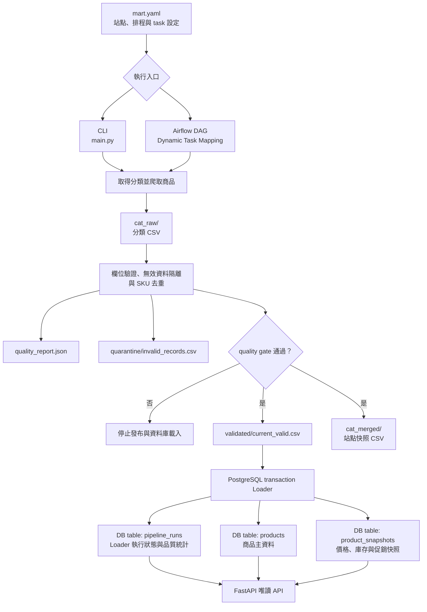

# Taiwan Retail Product Data Pipeline

> 一套整合多站點資料擷取、資料品質驗證、PostgreSQL 儲存與唯讀 API 的端到端資料工程專案。

本專案使用 Python 與 Playwright 擷取 7 個台灣零售通路與電商平台的商品資料，並透過 Apache Airflow 排程及平行處理各商品分類。
資料在寫入前會經過品質驗證、無效紀錄隔離與 SKU 去重，再由支援安全重跑的 Loader 載入獨立的 PostgreSQL 商品資料庫。
FastAPI 提供商品及 Pipeline 執行紀錄的唯讀查詢介面，Docker Compose 則整合本機開發所需的排程、訊息佇列、資料庫與 API 服務。

## Tech Stack

| 類別 | 技術 | 用途 |
|---|---|---|
| Language | Python | 實作爬蟲、資料處理、Loader 與 API。 |
| Web Scraping & Parsing | Playwright、Beautiful Soup、JMESPath、ChompJS | 透過瀏覽器操作與 API 請求擷取資料，並解析 HTML、JSON 及網頁內嵌 JavaScript。 |
| Workflow Orchestration | Apache Airflow | 排程並協調分類取得、爬取、驗證與資料載入流程。 |
| Task Queue | Celery、Redis | 執行 Airflow 分散式任務與提供訊息佇列。 |
| Database | PostgreSQL | 分別保存 Airflow metadata 與商品 warehouse 資料。 |
| API | FastAPI | 提供商品與 Pipeline 執行紀錄的唯讀查詢介面。 |
| Containerization | Docker Compose | 建立並整合本機開發所需的服務。 |
| Dependency Management | Poetry | 管理 Python dependencies 與虛擬環境。 |
| Testing | Pytest | 執行單元測試、API 測試與 PostgreSQL integration tests。 |

## Features

- **多站點爬取**：透過統一介面擷取 7 個台灣零售通路與電商平台的商品資料。
- **設定驅動執行**：使用 `mart.yaml` 管理各站點、排程、爬蟲類別與 task 設定。
- **平行分類處理**：Airflow 使用 Dynamic Task Mapping，依商品分類展開爬取任務。
- **資料品質控管**：寫入資料庫前執行欄位驗證、無效資料隔離、SKU 去重與 quality gate。
- **可追蹤的執行產物**：每次執行獨立保存原始資料、有效資料、隔離資料、品質報告與合併快照。
- **可安全重跑的資料載入**：Loader 使用 PostgreSQL transaction 與 UPSERT，避免同一次執行產生重複資料。
- **商品歷史與唯讀 API**：保存商品價格、庫存及促銷快照，並提供篩選、分頁、歷史資料及 Pipeline 執行紀錄查詢。

## Supported Sites and Schedules

Airflow 依 `scrapers/mart.yaml` 建立各站點的 DAG，所有排程均使用台北時間（`Asia/Taipei`）：

| Site ID | DAG ID | 每日執行時間 | Cron expression |
|---|---|---|---|
| `prosperity` | `run_prosperity_scraper` | 00:05 | `5 0 * * *` |
| `etmall` | `run_etmall_scraper` | 01:00、13:00 | `0 1,13 * * *` |
| `goshopping` | `run_goshopping_scraper` | 02:00、14:00 | `0 2,14 * * *` |
| `rtmart` | `run_rtmart_scraper` | 02:30、14:30 | `30 2,14 * * *` |
| `pxgo` | `run_pxgo_scraper` | 03:10、15:10 | `10 3,15 * * *` |
| `tsannkuen` | `run_tsannkuen_scraper` | 05:00、17:00 | `0 5,17 * * *` |
| `pxmart` | `run_pxmart_scraper` | 07:10、19:10 | `10 7,19 * * *` |

排程只適用於 Airflow DAG；使用 CLI 執行站點時會立即開始，不受上述時間限制。若調整 `mart.yaml` 的 `schedule`，Airflow 重新載入 DAG 後會套用新的排程。

## Data Flow



- CLI 依序執行單一站點；Airflow 使用 Dynamic Task Mapping 平行展開各商品分類。兩種入口最後都會執行相同的資料品質檢查與 PostgreSQL Loader。
- 每次執行的 artifacts 會寫入 `airflow/mnts/output/data/<site>/csv/YYYY/MM/DD/run_HHMMSS/`。`quality_report.json` 記錄 quality gate 狀態與筆數，`quarantine/invalid_records.csv` 保存未通過驗證的資料。
- Quality gate 通過後才會產生 `validated/current_valid.csv` 與 `cat_merged` 站點快照。Loader 只讀取本次執行的 `current_valid.csv` 與 `quality_report.json`，不會將 `cat_merged` 當成本次資料重新載入。
- Loader 以 transaction 更新 `pipeline_runs`、UPSERT `products` 並寫入 `product_snapshots`。相同站點與排程時間可安全重跑；transaction 失敗時會 rollback 商品資料並記錄 failed run。
- Airflow 若無法取得分類或任一 mapped category task 失敗，後續驗證與 Loader 不會執行。若沒有可讀取的輸入、沒有本次有效資料或 quality gate 未通過，也不會寫入商品資料庫。

## Installation

### 前置需求

- Docker Desktop 或 Docker Engine，並支援 Docker Compose v2
- Python 3.11 與 Poetry（僅在本機執行 CLI 或測試時需要）
- Git

先複製專案並進入根目錄：

```bash
git clone https://github.com/SandyCCT/taiwan-retail-data-pipeline.git
cd taiwan-retail-data-pipeline
```

從專案根目錄建立本機環境變數檔：

```bash
cp airflow/.env.example airflow/.env
```

開啟 `airflow/.env`，將 `WAREHOUSE_DB_PASSWORD` 改成本機使用的密碼。

若需要在本機執行 CLI 或測試，安裝 Python dependencies 與 Playwright Chromium：

```bash
cd airflow/mnts/codes
poetry env use 3.11
poetry install
poetry run playwright install chromium
```

## Environment Variables

### `airflow/.env`

專案設定集中在 [`airflow/.env.example`](airflow/.env.example)。將範本複製為 `airflow/.env` 後，依本機環境設定下列變數。

| 變數 | 範例 | 說明 |
|---|---|---|
| `AIRFLOW_UID` | `50000` | Airflow containers 寫入掛載目錄時使用的 user ID。Linux 建議改成 `id -u` 的輸出；Docker Desktop 通常可保留範本值。 |
| `WAREHOUSE_DB_HOST` | `localhost` | 商品資料庫主機。Host 上執行的 CLI 使用 `localhost`；Airflow 與 FastAPI containers 會由 Compose 固定改用 `warehouse-postgres`。 |
| `WAREHOUSE_DB_NAME` | `product_warehouse` | 商品資料庫名稱，同時提供 PostgreSQL 建庫及應用程式連線使用。 |
| `WAREHOUSE_DB_USER` | `crawler_app` | 商品資料庫使用者名稱，同時提供 PostgreSQL 建立使用者及應用程式連線使用。 |
| `WAREHOUSE_DB_PASSWORD` | `replace_with_a_local_password` | 商品資料庫密碼，由 PostgreSQL、CLI、Airflow 與 FastAPI 共用。 |
| `WAREHOUSE_DB_PORT` | `5433` | 商品資料庫發布到 host 的 port，供本機 CLI 或資料庫工具連線。Containers 之間固定使用 PostgreSQL port `5432`。 |
| `WAREHOUSE_DB_CONNECT_TIMEOUT` | `10` | 應用程式等待商品資料庫建立連線的秒數，必須是大於 `0` 的整數。 |
| `PRODUCT_API_PORT` | `8000` | FastAPI 發布到 host 的 port；container 內固定監聽 `8000`。若 host 的 `8000` 已被占用，可修改此值。 |

設定範例：

```dotenv
AIRFLOW_UID=50000
WAREHOUSE_DB_HOST=localhost
WAREHOUSE_DB_NAME=product_warehouse
WAREHOUSE_DB_USER=crawler_app
WAREHOUSE_DB_PASSWORD=replace_with_a_local_password
WAREHOUSE_DB_PORT=5433
WAREHOUSE_DB_CONNECT_TIMEOUT=10
PRODUCT_API_PORT=8000
```

### `airflow/.env.e2e`

執行 PostgreSQL warehouse integration tests 前，從 [`airflow/.env.e2e.example`](airflow/.env.e2e.example) 產生本機測試設定：

```bash
cp airflow/.env.e2e.example airflow/.env.e2e
```

`.env.e2e.example` 內容：

```dotenv
# Isolated PostgreSQL settings for warehouse integration tests.
WAREHOUSE_DB_HOST=localhost
WAREHOUSE_DB_NAME=product_warehouse_e2e
WAREHOUSE_DB_USER=crawler_e2e
WAREHOUSE_DB_PASSWORD=change_me_e2e
WAREHOUSE_DB_PORT=55434
WAREHOUSE_DB_CONNECT_TIMEOUT=10
```

| 變數 | 設定要求 |
|---|---|
| `WAREHOUSE_DB_HOST` | E2E 腳本只接受 `localhost` 或 `127.0.0.1`。 |
| `WAREHOUSE_DB_NAME` | 測試資料庫名稱必須包含 `e2e`，避免指向一般商品資料庫。 |
| `WAREHOUSE_DB_USER` | E2E PostgreSQL 使用者名稱，應與一般商品資料庫使用者區分。 |
| `WAREHOUSE_DB_PASSWORD` | E2E PostgreSQL 使用者密碼，可將範例值換成本機測試密碼。 |
| `WAREHOUSE_DB_PORT` | 測試資料庫發布到 host 的 port；不可使用一般商品資料庫的 `5433`，若 `55434` 已被占用可改用其他 port。 |
| `WAREHOUSE_DB_CONNECT_TIMEOUT` | 測試等待 PostgreSQL 建立連線的秒數，範例使用 `10`。 |

測試腳本固定讀取 `airflow/.env.e2e`。此檔案只保存本機測試設定。

### `mart.yaml`

[`airflow/mnts/codes/scrapers/mart.yaml`](airflow/mnts/codes/scrapers/mart.yaml) 集中管理各網站的 scraper 與 Airflow 排程設定。每個網站使用一組相同結構的設定：

| 設定 | 說明 |
|---|---|
| Site ID | 網站識別名稱，例如 `etmall`。同時用於 CLI 參數、Airflow tag、輸出目錄與資料庫的 `site_id`。 |
| `scraper_name` | 對應的 scraper module 與 class 名稱，例如 `etmall_scraper`。 |
| `schedule` | Airflow Cron 排程，使用 `Asia/Taipei` 時區；設為 `null` 時不會自動排程。 |
| `max_active_tasks` | 此網站 DAG 可同時執行的 task 上限，必須是正整數；省略時使用 `16`。 |
| `category_args` | 傳入 `scrape_one_category()` 的分類欄位名稱與順序，必須與 `get_categories()` 回傳的 keys 一致。 |
| `independent_run_mode` | `true` 表示本次執行獨立產生快照；`false` 表示合併同一天較早執行產生的資料。 |

ETMall 設定範例：

```yaml
etmall:
  scraper_name: "etmall_scraper"
  schedule: "0 1,13 * * *"
  max_active_tasks: 5
  category_args: ["cat_name", "subcat_name", "subcat_url"]
  independent_run_mode: true
```

此範例會建立 ETMall DAG，每天台北時間 `01:00` 與 `13:00` 執行，並允許同時執行最多 5 個 tasks。

## How to Run

### 啟動完整本機環境

從專案根目錄進入 `airflow/`，建置 image 並啟動服務：

```bash
cd airflow
docker compose build
docker compose up -d
docker compose ps
```

服務啟動後可開啟；FastAPI URL 使用 `PRODUCT_API_PORT=8000` 的預設值：

- Airflow UI：<http://localhost:8080>
- FastAPI Swagger UI：<http://localhost:8000/docs>
- Airflow 本機預設帳號與密碼：`airflow` / `airflow`

DAG 建立後預設為 paused。需要排程執行時，請在 Airflow UI 啟用對應站點的 DAG。

### 使用 CLI 執行單一站點

CLI 完成爬取與品質驗證後，會將有效資料載入 PostgreSQL，因此應先從專案根目錄啟動商品資料庫：

```bash
cd airflow
docker compose up -d warehouse-postgres
cd mnts/codes
```

不帶站點參數時，只會列出可用站點：

```bash
poetry run python main.py
```

傳入站點名稱後，才會執行實際爬取，例如執行 ETMall：

```bash
poetry run python main.py etmall
```

## Stop and Cleanup

以下指令均從 `airflow/` 目錄執行。

### 停止並移除 containers

```bash
docker compose down
```

此指令會移除 Compose 建立的 containers 與 network，但保留 images 和 PostgreSQL named volumes。下次啟動時，既有資料仍會存在。

### 重建全新的本機資料庫

```bash
docker compose down --volumes
docker compose up -d
```

`--volumes` 會移除 Airflow metadata 與商品 warehouse 的 named volumes，其中的資料會永久消失。只應在確定不需要現有資料時使用。

### 重新建置 images

```bash
docker compose build --no-cache
docker compose up -d
```

適合 Dockerfile 或 dependencies 更新後，需要忽略既有 build cache 重新建置時使用。

## Basic Usage

### 可用站點

CLI 與 Airflow 共用 `scrapers/mart.yaml` 的站點設定。目前可用的 site ID 為：

```text
prosperity, pxgo, goshopping, tsannkuen, pxmart, rtmart, etmall
```

從專案根目錄執行 CLI：

```bash
cd airflow/mnts/codes
poetry run python main.py <site_id>
```

Airflow 執行單一站點時，會依序取得分類、平行爬取各分類、驗證並合併資料，最後將通過 quality gate 的資料載入商品資料庫。

### 查詢 API

FastAPI 僅提供唯讀查詢。以下範例使用 `PRODUCT_API_PORT=8000` 的預設值：

```bash
curl http://localhost:8000/health
curl "http://localhost:8000/products?site_id=etmall&limit=10"
curl "http://localhost:8000/pipeline-runs?site_id=etmall&limit=10"
```

`products` 可依站點與商品名稱篩選，`pipeline-runs` 可依站點與執行狀態篩選；完整參數與 response schema 可在 Swagger UI 查看。

Host 上的 CLI 透過 `localhost:5433` 連接商品資料庫；Airflow 與 FastAPI containers 則透過 Compose network 使用 `warehouse-postgres:5432`。

## Output Artifacts

每次執行會依台北時間建立獨立的 run 目錄：

```text
airflow/mnts/output/data/<site>/csv/YYYY/MM/DD/run_HHMMSS/
├── cat_raw/
│   └── <category>_YYYYMMDD_HHMMSS.csv
├── cat_merged/
│   └── <site>_all_data_YYYYMMDD_HHMMSS.csv
├── validated/
│   └── current_valid.csv
├── quarantine/
│   └── invalid_records.csv
└── quality_report.json
```

| Artifact | 用途 | 產生條件 |
|---|---|---|
| `cat_raw/*.csv` | 本次執行各商品分類的爬取結果，也是 quality gate 的輸入。 | 各分類取得商品資料後寫入。 |
| `quarantine/invalid_records.csv` | 保存未通過驗證的資料、來源檔案、來源列號與 rejection reason；沒有無效資料時仍保留欄位標題。 | 進入驗證與合併階段後產生。 |
| `quality_report.json` | 記錄 `status`、`can_publish`、資料筆數、違規統計及輸入錯誤。 | 進入驗證與合併階段後產生。 |
| `validated/current_valid.csv` | 本次執行通過驗證並依 SKU 去重的資料，是 PostgreSQL Loader 的商品輸入。 | Quality gate 通過時產生。 |
| `cat_merged/*.csv` | 依 SKU 去重後的站點快照；`independent_run_mode=false` 時可包含同一天較早執行的資料。 | Quality gate 通過時產生。 |

PostgreSQL Loader 只讀取本次 run 的 `validated/current_valid.csv` 與 `quality_report.json`。`cat_merged` 用於保留站點快照及累積模式，不會被當成本次資料重新載入。

## Database Schema

### Database isolation

Airflow 系統資料與商品資料使用不同的 PostgreSQL services、database volumes 及連線設定：

| 用途 | Compose service | PostgreSQL | 連線位置 |
|---|---|---|---|
| Airflow metadata 與 Celery results | `postgres` | 13 | 僅供 Compose 內部使用：`postgres:5432` |
| 商品 warehouse | `warehouse-postgres` | 16.15 | Host 預設使用 `localhost:5433`；containers 使用 `warehouse-postgres:5432` |

Scraper Loader 只寫入商品 warehouse，FastAPI 也只讀取商品 warehouse，不會存取 Airflow metadata database。

### Tables

| Table | 用途 | Key 與主要欄位 |
|---|---|---|
| `pipeline_runs` | 記錄 Loader 執行狀態與本次資料品質統計。 | `run_id` 為 Primary Key；`(site_id, scheduled_at)` 必須唯一。主要欄位包括 `status`、`run_type`、各階段筆數與 `error_message`。 |
| `products` | 保存商品名稱、品牌、網址、規格、描述與分類等相對穩定的資料。 | `product_id` 為 Primary Key；`(site_id, sku)` 必須唯一。 |
| `product_snapshots` | 保存每次 run 觀察到的價格、庫存、促銷與觀察時間。 | `snapshot_id` 為 Primary Key；`run_id` 與 `product_id` 為 Foreign Keys；`(run_id, product_id)` 必須唯一。 |

資料表關係：

- 一筆 `pipeline_runs` 可以對應多筆 `product_snapshots`。
- 一筆 `products` 可以在不同 runs 中對應多筆 `product_snapshots`。
- `product_snapshots` 的價格不可為負數，`discount_rate` 必須介於 `0` 到 `100`，`stock` 使用 PostgreSQL `INTEGER[]`。
- `product_snapshots (product_id, observed_at DESC)` 建有 index，供商品歷史資料依時間查詢。

### Initialization and loading

[`001_create_warehouse.sql`](airflow/mnts/codes/db/init/001_create_warehouse.sql) 會在商品資料庫第一次以空 volume 啟動時建立 tables、constraints 與 index。既有 PostgreSQL volume 不會再次執行初始化 SQL。

Loader 以同一個 transaction 寫入 `pipeline_runs`、UPSERT `products` 並新增或更新 `product_snapshots`。相同 `site_id` 與 `scheduled_at` 會產生相同的 `run_id`，因此同一次 run 可安全重跑。若 transaction 失敗，商品與 snapshot 變更會 rollback，Loader 再以獨立 transaction 記錄 failed run。

`pipeline_runs.started_at` 與 `finished_at` 表示 Loader 的執行區間，不包含前面的爬蟲與資料驗證時間。

## Backfill

`warehouse.backfill` 用於將既有的 `cat_merged` CSV 匯入商品 warehouse，為一個**尚無商品資料的站點**建立初始 baseline。這是一項一次性的初始化操作，不適合取代日常的 CLI 或 Airflow Loader，也不能用來覆蓋或補寫已有商品資料的站點。

執行前請確認：

- 目標 `site_id` 在 `products` table 中尚無商品；若已有資料，程式會停止並回報錯誤。
- `--csv` 指向要作為初始 baseline 的 `cat_merged` CSV。
- `--backfill-at` 使用與該快照對應、包含時區的固定 ISO timestamp，例如 `2026-09-01T09:00:00+08:00`。

從專案根目錄執行：

```bash
cd airflow/mnts/codes

set -a
source ../../.env
set +a

poetry run python -m warehouse.backfill \
  --site-id etmall \
  --csv /absolute/path/to/etmall_all_data.csv \
  --backfill-at 2026-09-01T09:00:00+08:00
```

Backfill 會先驗證 CSV，保留每個 SKU 最新的一筆有效資料，再以 transaction 寫入 warehouse。相同的 `site_id` 與 `--backfill-at` 會產生相同的 `run_id`，成功後可使用相同參數安全重跑；`pipeline_runs.run_type` 會記錄為 `backfill`。

## API Endpoints

FastAPI 提供商品 warehouse 的唯讀查詢介面。以下 URL 使用 `PRODUCT_API_PORT=8000` 的預設值：

- Base URL：<http://localhost:8000>
- Swagger UI：<http://localhost:8000/docs>
- OpenAPI schema：<http://localhost:8000/openapi.json>

| Method | Endpoint | 用途 | Query parameters |
|---|---|---|---|
| `GET` | `/health` | 確認 API 能否連線至商品 warehouse。 | 無 |
| `GET` | `/products` | 查詢商品清單及各商品最新的一筆 snapshot。 | `site_id`、`name`、`limit`、`offset` |
| `GET` | `/products/{site_id}/{sku}` | 依 site ID 與 SKU 查詢單一商品及最新 snapshot。 | 無 |
| `GET` | `/products/{site_id}/{sku}/history` | 查詢單一商品由新到舊的價格、庫存與促銷紀錄。 | `limit`、`offset` |
| `GET` | `/pipeline-runs` | 查詢 Loader 執行紀錄及各階段資料筆數。 | `site_id`、`status`、`limit`、`offset` |
| `GET` | `/pipeline-runs/{run_id}` | 依 UUID 查詢單一 Loader 執行紀錄。 | 無 |

`site_id` 與 `name` 為選用篩選條件；`name` 會比對商品名稱。`status` 只接受 `running`、`success` 或 `failed`。清單與歷史 endpoints 的 `limit` 預設為 `50`，範圍為 `1` 至 `100`；`offset` 預設為 `0`，用於分頁位移。

查詢商品明細：

```bash
curl "http://localhost:8000/products/etmall/<sku>"
```

查詢商品歷史資料：

```bash
curl "http://localhost:8000/products/etmall/<sku>/history?limit=10&offset=0"
```

查詢單次 Pipeline run：

```bash
curl "http://localhost:8000/pipeline-runs/<run_id>"
```

API 成功時回傳 `200`。找不到指定商品或 Pipeline run 時回傳 `404`；path 或 query parameter 格式不正確時回傳 `422`；商品 warehouse 無法連線時回傳 `503`；未預期的伺服器錯誤則回傳 `500`。錯誤 response 使用 `{"detail": "..."}` 格式，且不會回傳資料庫密碼或內部例外內容。

## Testing

測試主要使用 repository 內的 fixtures，不需連線至真實購物網站。測試範圍包括 scraper 資料解析、商品資料模型、共用工具、quality gate、PostgreSQL Loader、backfill 與 FastAPI。

### 一般測試

從專案根目錄執行：

```bash
cd airflow/mnts/codes
poetry run pytest
```

`test_warehouse_loader_integration.py` 預設會被跳過，只有在明確設定 `WAREHOUSE_INTEGRATION_TEST=1` 且連到隔離測試資料庫時才會執行。

### PostgreSQL integration tests

第一次執行前，從專案根目錄建立 E2E 設定；若已建立並調整過 `airflow/.env.e2e`，不需再次複製：

各變數的內容與設定限制，請參考前面的 `Environment Variables` → `airflow/.env.e2e`。

```bash
cp airflow/.env.e2e.example airflow/.env.e2e
```

確認 E2E database 名稱包含 `e2e`，且未使用一般商品資料庫的 host port `5433`，再執行：

```bash
cd airflow
./scripts/run_warehouse_integration_tests.sh
```

此腳本只啟動 `docker-compose.e2e.yaml` 中的 PostgreSQL，並使用 tmpfs 建立全新測試資料庫。腳本會設定 integration test flag、執行真實 PostgreSQL 寫入、重跑與 rollback 測試，結束或中斷時自動停止 E2E Compose project。正式商品資料庫與 named volumes 不會被使用。

### GitHub Actions

GitHub Actions 會在 push 到 `main`、Pull Request 及手動觸發時執行以下檢查：

- 使用 Python 3.11 執行一般 Pytest。
- 驗證 Docker Compose 設定。
- 啟動隔離的 PostgreSQL test database，執行 warehouse integration tests，並在測試結束後停止 E2E Compose project。

## Project Structure

```text
taiwan-retail-data-pipeline/
├── README.md                              # 專案說明與操作方式
├── .gitignore                             # Git 排除規則
├── .github/
│   └── workflows/ci.yml                   # GitHub Actions 離線測試
└── airflow/
    ├── .env.example                       # 一般本機環境變數範本
    ├── .env.e2e.example                   # E2E 測試環境變數範本
    ├── docker-compose.yaml                # 完整本機開發環境
    ├── docker-compose.e2e.yaml            # 隔離的 E2E PostgreSQL
    ├── scripts/
    │   └── run_warehouse_integration_tests.sh
    ├── 0_dockerize/airflow_new/
    │   ├── Dockerfile                     # Airflow 自訂 image
    │   └── requirements.txt               # Airflow image dependencies
    ├── dags/
    │   └── generate_scraper_dags.py       # 依網站設定動態建立 DAG
    └── mnts/
        ├── codes/
        │   ├── main.py                    # CLI 入口
        │   ├── pyproject.toml             # Python 專案與 dependencies
        │   ├── poetry.lock                # Poetry 鎖定版本
        │   ├── Dockerfile.api             # FastAPI image
        │   ├── requirements-api.txt       # FastAPI image dependencies
        │   ├── api/
        │   │   ├── main.py                # FastAPI application 入口
        │   │   ├── dependencies.py        # Database connection dependency
        │   │   ├── repositories.py        # 唯讀 SQL queries
        │   │   ├── schemas.py             # API response models
        │   │   └── routers/               # Health、products、pipeline runs
        │   ├── db/init/
        │   │   └── 001_create_warehouse.sql
        │   ├── scrapers/
        │   │   ├── mart.yaml              # 網站、排程與 task 設定
        │   │   ├── base_scraper_async.py  # Scraper 共用基底
        │   │   ├── items.py               # 商品資料模型
        │   │   ├── quality.py             # 資料品質驗證
        │   │   ├── utility.py             # 爬取、重試與合併工具
        │   │   └── <site>/                # 各網站 scraper
        │   ├── warehouse/
        │   │   ├── database.py            # PostgreSQL 連線設定
        │   │   ├── loader.py              # 將通過 quality gate 的資料寫入 PostgreSQL
        │   │   └── backfill.py            # 歷史 CSV backfill
        │   └── tests/                      # Unit、API 與 warehouse tests
        └── output/                         # 執行時產生的 CSV 與品質報告
```
